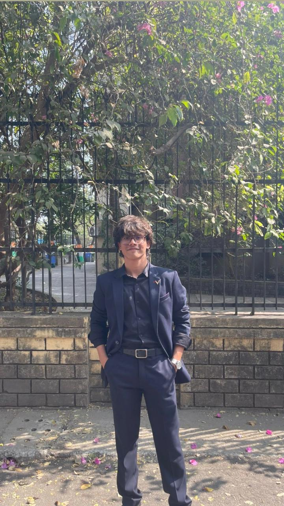

<!-- ==================== HERO SECTION ==================== -->

 

  

 

<!-- ==================== ABOUT ME ==================== -->
<h2 align="center">✦ &nbsp; BEYOND THE CODE &nbsp; ✦</h2>

<table>
<tr>
<td width="62%" valign="middle">

### Hello, I'm Manas!

Currently pursuing an **Undergraduate Degree in Information Technology** at **St. Francis Institute of Technology, Mumbai**.

I enjoy exploring technology, understanding how things work, and turning concepts into practical projects.

My focus is on strengthening my programming fundamentals, exploring development tools, and continuously learning new technologies.

 

</td>

<td width="38%" align="center" valign="middle">

</td>
</tr>
</table>

 

<!-- ==================== TECH STACK ==================== -->
<h2 align="center">✦ &nbsp; MY TECHNOLOGY UNIVERSE &nbsp; ✦</h2>

 

<!-- ==================== PROJECTS ==================== -->
<h2 align="center">✦ &nbsp; SELECTED PROJECTS &nbsp; ✦</h2>

<i>Ideas are only the beginning. Building is where they come alive.</i>

Currently learning, experimenting, and working towards building practical projects.

 

<!-- ==================== GOALS ==================== -->
<h2 align="center">✦ &nbsp; WHAT'S NEXT? &nbsp; ✦</h2>

<table>
<tr>

<td align="center" width="33%">
<h3>01</h3>
<b>BUILD</b>
  
Create practical projects and strengthen development skills.
</td>

<td align="center" width="33%">
<h3>02</h3>
<b>EXPLORE</b>
  
Discover new technologies and expand technical knowledge.
</td>

<td align="center" width="33%">
<h3>03</h3>
<b>GROW</b>
  
Gain experience and collaborate on meaningful work.
</td>

</tr>
</table>

 

<!-- ==================== FOOTER ==================== -->

<b>Let's connect and build something meaningful.</b>
  

